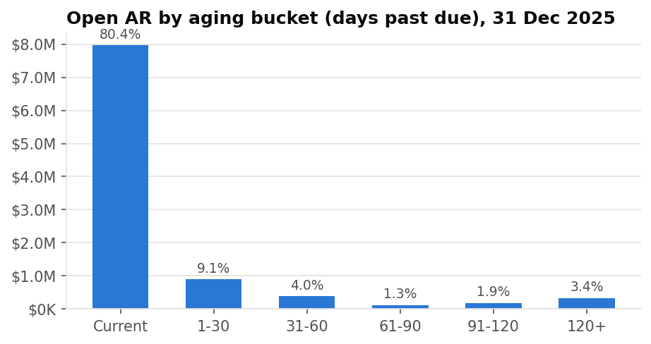
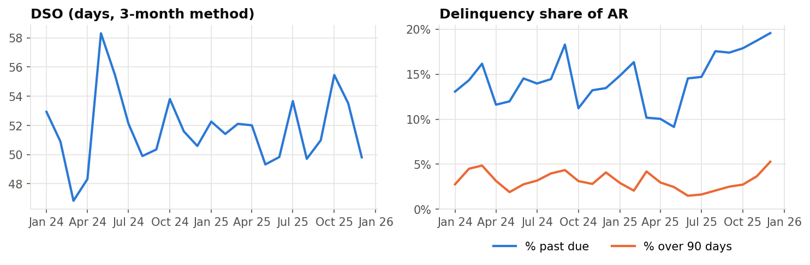
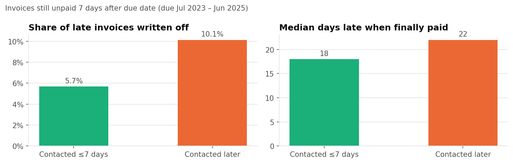
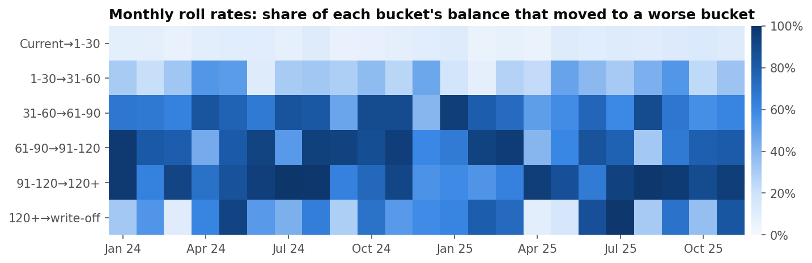
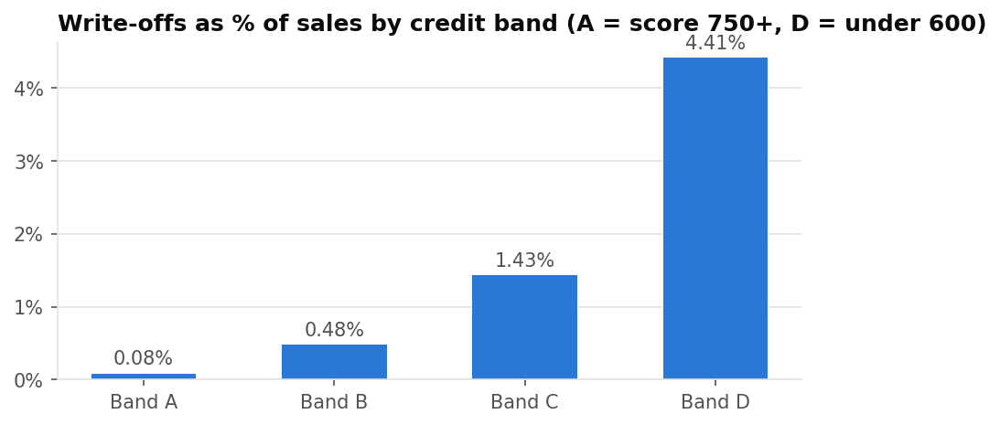
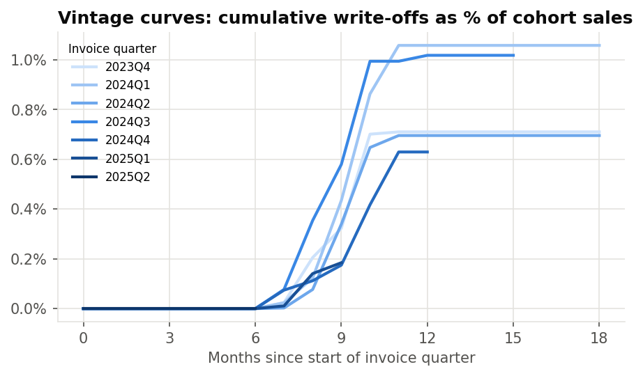

# Collections & Bad Debt Analysis

**An accounts-receivable risk analysis of a B2B portfolio, built with Excel, Power BI, Tableau, SQL and Python.**
It answers the questions a credit and collections team asks every month: *How much of our AR is late? How fast is
it rolling toward write-off? How much reserve do we need? Which collection habits actually reduce losses?*

> Data is **synthetic**: 400 customers, 11,562 invoices, 12,260 payments and 10,168 collector activities from
> Jul 2023 to Dec 2025, generated by [`src/generate_data.py`](src/generate_data.py). No real companies or people are included.
> Risk patterns are built in on purpose, so the analysis has real signal to find.



## Key findings (as of 31 Dec 2025)

| Metric | Value |
|---|---|
| Open AR | **$9.90M**, of which 19.6% is past due and 5.3% is over 90 days |
| DSO (3-month method) | **49.8 days** (Dec 2024: 50.6) |
| Collection Effectiveness Index | **79.7%** average for 2025 (2024: 81.0%) |
| Net bad debt | **0.74% of sales** in 2025 (2024: 0.63%) – $540K net write-offs |
| Required allowance (roll-rate method) | **$494,865 = 5.0% of AR**, about $75K more than the illustrative $420K booked reserve |

1. **Delinquency is rising even though DSO looks flat.** The share of AR past due rose from 13.5% to 19.6% over
   2025, but DSO barely moved. Tracking DSO alone would have missed the deterioration.
2. **Balances that reach 31–60 days usually keep rolling.** Over the last 12 months, 9.7% of current balances rolled
   into 1–30 days, but 68% of 31–60 balances moved to a worse bucket. Chaining the roll rates gives an implied
   loss of 0.6% on current AR but 21% at 31–60 days and 55% at 120+.
3. **Credit score separates risk sharply.** Write-offs run at 0.08% of sales for band A (score 750+)
   and 4.4% for band D (under 600). SMB customers lose 2.6% of sales and Enterprise customers 0.2%.
4. **Calling early pays off.** Among invoices still unpaid 7 days after their due date, those contacted within the first
   week were written off **5.7%** of the time, compared with **10.1%** for those contacted later. Their dollar loss rate was 3.4% vs 5.1%.
   This suggests a policy change: make the first contact within 7 days for every past-due account.

| | |
|---|---|
|  |  |
|  |  |



Full numbers: [`reports/findings.md`](reports/findings.md).

## What's in each tool

### Excel: [`excel/collections_dashboard.xlsx`](excel/collections_dashboard.xlsx)
An interactive workbook where every number is a live formula, with no macros and no hard-coded results.
- **Dashboard**: Region and Segment dropdowns drive 8 KPI cards and 6 charts, and every other sheet follows the same filters.
- **Aging**: aging by region, segment and credit band, with conditional formatting, plus a filter-aware top-10 past-due list (`LARGE` + `INDEX/MATCH`).
- **Roll Rates**: monthly migration matrix, 12-month balance-weighted roll rates, and the implied loss-rate chain.
- **Allowance**: reserve = AR × loss rate per bucket, with override inputs, a stress multiplier, and the gap against the booked reserve.
- **Collectors**: speed to first contact, promise-to-pay kept rate and net loss rate for each collector.
- Built by [`src/build_workbook.py`](src/build_workbook.py) using `SUMIFS`, `COUNTIFS`, `AVERAGEIFS`, `INDEX/MATCH`, `EOMONTH` and data validation.

### Power BI: [`powerbi/`](powerbi/)
The semantic model and report specification:
- **Power Query (M)**: parameterised CSV loads, null handling, and a self-merge of the month-end aging snapshot
  that builds the month-to-month **roll-rate fact table** ([`RollFacts.pq`](powerbi/power_query/RollFacts.pq)).
- **Data model**: star schema, a marked date table, and an inactive write-off-date relationship turned on with `USERELATIONSHIP`.
- **DAX** ([`measures.dax`](powerbi/measures.dax)): semi-additive snapshot balances, DSO, CEI averaged over months with
  `AVERAGEX`, roll rates, `PRODUCTX` loss-rate chains, a `SUMX` allowance, a what-if stress parameter, and collector KPIs.
- A 4-page report: executive overview, aging & risk, roll rates & allowance, and collector performance.

### Tableau: [`tableau/`](tableau/)
A risk-focused dashboard: roll-rate heatmap, vintage loss curves, a credit band × segment highlight table, the early-contact
test, and delinquency trends by region.

### SQL: [`sql/`](sql/)
The same metrics in plain SQL (SQLite / PostgreSQL style): aging by region, monthly DSO & CEI with window functions,
roll rates via a self-join on month-end snapshots, vintage loss curves with a recursive CTE, and the early-contact comparison.

## Metric definitions

| Metric | Definition |
|---|---|
| Aging bucket | Days past due on the open balance: Current, 1–30, 31–60, 61–90, 91–120, 120+ |
| DSO | Month-end AR ÷ credit sales of the last 3 months × days in those 3 months |
| CEI | (opening AR + sales − closing AR) ÷ (opening AR + sales − closing current AR), monthly |
| Roll rate | Share of a bucket's balance that is in a worse bucket (or written off) one month later; for 120+, written off ÷ (written off + paid) |
| Implied loss rate | Product of a bucket's roll rate and every later roll rate (12-month balance-weighted) |
| Required allowance | Σ open AR in bucket × implied loss rate |
| Net bad debt % | (write-offs − recoveries) ÷ credit sales, same period |

The Excel formulas, DAX measures, SQL and Python all use these definitions and produce the same numbers. The
[test suite](tests/) checks this: it evaluates the Excel formulas with a Python formula engine and compares them with pandas,
runs every SQL file against the data, and reconciles the ledger tables.

## Run it

```bash
pip install -r requirements.txt
python src/generate_data.py      # data/*.csv
python src/build_workbook.py     # excel/collections_dashboard.xlsx
python src/analysis.py           # figures/*.png and reports/findings.md
pip install -r requirements-test.txt && pytest -q
```

## Repository layout

```
data/        customers, invoices, payments, collection_activities, aging_snapshot,
             aging_history, roll_rates, dim_date (CSV)
excel/       collections_dashboard.xlsx
powerbi/     Power Query scripts, DAX measures, theme, build guide
tableau/     calculated fields and build guide
sql/         01-05 analysis queries
src/         generate_data.py, build_workbook.py, analysis.py
figures/     charts used in this README
reports/     findings.md
tests/       data integrity, SQL and Excel formula tests
```
